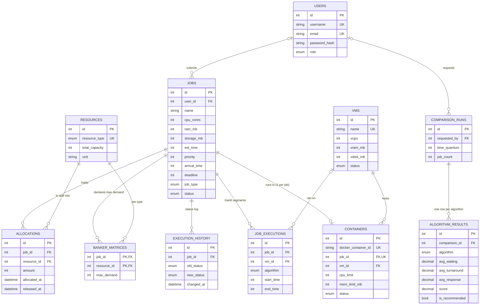

# CloudSched – DBMS design

Files: `database/01_schema.sql` (tables, keys, constraints, indexes) · `02_views.sql` · `03_procedures.sql` · `04_triggers.sql` ·
`05_seed_data.sql` · `06_analytical_queries.sql` · `07_transactions_demo.sql`. Target: **MySQL 8.0.16+**, InnoDB.

## 1. ER diagram

Relationship cardinalities: a user submits many jobs (a job may have no user: the Phase A REST API creates anonymous jobs); a job has
one allocation row per resource type (3 rows), at most one container, many history rows; `ALLOCATIONS` and `BANKER_MATRICES` are the two
resolution tables of the many-to-many relationship *job ↔ resource*.

## 2. Mapping to the project's names

| Project report table | Implemented as |
|---|---|
| Users, Jobs, Resources, Allocations, ExecutionHistory, VMs, Containers | `users`, `jobs`, `resources`, `allocations`, `execution_history`, `vms`, `containers` |
| BankerMatrices (Max, Allocation, Need, Available) | `banker_matrices` stores **Max**. Allocation, Need and Available are **derived** in views `v_banker_matrices` and `v_resource_usage` |
| AlgorithmResults | `comparison_runs` (one comparison) + `algorithm_results` (one row per algorithm) |
| (new) Gantt chart data | `job_executions` + view `v_gantt` |

## 3. Normalisation (1NF → 3NF)

**Starting point (unnormalised).** One wide sheet `Jobs_Flat(job_id, name, user_name, user_email, cpu, ram, storage, status, status_history, resource_type, unit, total_capacity, allocated, available, vm_name, vm_vcpu, container_id …)`.

* **1NF – atomic values, no repeating groups.** `status_history` (a list) becomes rows of `execution_history`; the repeated resource columns (cpu/ram/storage) become rows of `allocations` and `banker_matrices` keyed by resource type.
* **2NF – no partial dependency on part of a composite key.** In `allocations` the candidate key is `(job_id, resource_id)`; `amount` depends on the whole key. Job facts (`name`, `priority`) depend on `job_id` alone, so they live in `jobs`; resource facts (`unit`, `total_capacity`) depend on `resource_id` alone, so they live in `resources`.
* **3NF – no transitive dependency on a non-key attribute.**

| Dependency that would be transitive | Where it was removed |
|---|---|
| `job → user_id → user_name, email` | `users` holds name and email; `jobs` keeps only `user_id` |
| `allocation → resource_id → unit, total_capacity` | `resources` |
| `container → vm_id → vm_vcpu, vm_vram` | `vms`; the container stores only `vm_id` and its own limits |
| `container → job_id → job_type → image` | the image is **not stored** in `containers`; it is derived from `jobs.job_type` |
| `algorithm_result → comparison_id → time_quantum, job_count` | `comparison_runs` |

Functional dependencies per table (every determinant is a candidate key, so each table is also in BCNF):
`users: id → *, username → *, email → *` · `resources: id → *, resource_type → unit, total_capacity` · `jobs: id → *` ·
`allocations: id → *, (job_id, resource_id) → amount, times` · `banker_matrices: (job_id, resource_id) → max_demand` ·
`vms: id → *, name → *` · `containers: id → *, job_id → *` · `algorithm_results: id → *, (comparison_id, algorithm) → metrics`.

**Derived data that is deliberately NOT stored** (storing it would create update anomalies; the views compute it on demand):
`allocated` / `available` per resource (`v_resource_usage`), Banker's `Allocation` and `Need` (`v_banker_matrices`), per-job
`waiting / turnaround / response` time (`v_job_metrics`), free capacity of a VM (`v_vm_status`).

**One intentional exception.** `algorithm_results` stores metrics that *could* be recomputed. They are a **snapshot of a simulation** at one moment
(with a given quantum and weights); the underlying workload can change later, so the stored numbers are history, not redundant copies of live data.

## 4. Integrity constraints

| Kind | Examples |
|---|---|
| Primary keys | every table; composite PK on `banker_matrices (job_id, resource_id)` |
| Foreign keys | `jobs.user_id`, `allocations.job_id/resource_id`, `containers.job_id/vm_id`, … with `ON DELETE CASCADE` (history, Gantt, matrices), `SET NULL` (user removed), `RESTRICT` (resources, VMs in use) |
| UNIQUE | `users.username/email`, `resources.resource_type`, `vms.name`, `containers.job_id` (1 container per job), `allocations (job_id, resource_id)` (1 allocation per job and resource) |
| NOT NULL / DEFAULT | all mandatory columns; defaults for `status`, `priority`, `created_at` |
| CHECK | positive CPU/RAM/time, `priority BETWEEN 1 AND 10`, `deadline > arrival_time`, `end_time > start_time`, `released_at >= allocated_at`, utilisation 0–100 |
| "One winner" rule | generated column `rec_marker` + `UNIQUE (comparison_id, rec_marker)`: at most one recommended algorithm per comparison |

## 5. Indexes (and why)

| Index | Query it serves |
|---|---|
| `jobs (status, priority, arrival_time)` | ready queue `WHERE status='WAITING' ORDER BY priority, arrival_time` (no filesort) |
| `allocations (resource_id, released_at)` | `SUM(amount)` of active allocations per resource (used on every allocation) |
| `execution_history (job_id, changed_at)` | audit trail of one job in time order |
| `containers (vm_id, status)` | free capacity of a VM |
| `algorithm_results (comparison_id, score)` | ranking inside a comparison |

Foreign-key columns are indexed automatically by InnoDB. `06_analytical_queries.sql` Q18 shows `EXPLAIN` with and without the queue index.

## 6. Triggers

| # | Trigger | Rule |
|---|---|---|
| T1 | `trg_jobs_bu_status_guard` | only legal moves: SUBMITTED→WAITING/CANCELLED, WAITING→RUNNING/CANCELLED, RUNNING→COMPLETED/FAILED (same table as `ALLOWED` in `job_service.py`, now enforced for every writer) |
| T2 | `trg_jobs_ai_init` | new job: log first status, create its Banker's Max rows (max = request) |
| T3 | `trg_jobs_au_log_release` | log every status change; when a RUNNING job ends, stamp `released_at` on its allocations and close its container |
| T4 | `trg_jobs_bd_protect_running` | a RUNNING job cannot be deleted |
| T5 | `trg_alloc_bi_guard` | allocation only for a WAITING job, ≤ Banker's Max, and total ≤ host capacity (takes the resource row lock itself) |
| T6 | `trg_vms_bi_capacity` | all VMs together must fit on the physical host |
| T7 | `trg_vms_bu_lifecycle` | VM lifecycle CREATED→RUNNING↔STOPPED→DESTROYED; no stop/destroy with active containers; resize re-checks the host |
| T8 | `trg_cont_bi_capacity` | container only for a RUNNING job in a RUNNING VM with enough free vCPU/RAM (VM row locked) |

## 7. Stored procedures

| Procedure | Purpose |
|---|---|
| `sp_submit_job` | admission control (reject if larger than the host) + insert, one transaction |
| `sp_bankers_check` | Banker's **safety algorithm in SQL** (temp table, Work vector, loop until no job can finish). Same logic as `bankers_algorithm.is_safe` |
| `sp_allocate_job` | **the ACID allocation**: lock resources → lock job → availability check → Banker's check → insert allocations → job RUNNING → COMMIT. Returns `GRANTED / DEFERRED_UNAVAILABLE / DEFERRED_UNSAFE / INVALID` |
| `sp_release_job` | finish a job (COMPLETED/FAILED); trigger T3 frees the resources |
| `sp_dispatch_waiting` | after a release, start waiting jobs in FCFS / SJF / PRIORITY / PRIORITY_AGING order (backfilling, aging reserves like `cluster_sim.py`) |
| `sp_place_job_on_vm` | best-fit placement of a RUNNING job into a RUNNING VM, creates the container row |
| `sp_mark_recommended` | flags the lowest-score algorithm of a comparison |
| `sp_assert_vm_capacity` | helper used by T6/T7 |

## 8. Transactions and concurrency control

* **Atomicity:** each procedure is one transaction with an `EXIT HANDLER` that does `ROLLBACK` and re-raises. A failed allocation leaves no partial rows.
* **Consistency:** CHECK/FK/UNIQUE constraints plus triggers T1–T8 reject any state that breaks the invariants (`available ≥ 0`, `allocated ≤ total`, one allocation per job, released exactly once).
* **Isolation:** pessimistic **row-level locking** (`SELECT … FOR UPDATE`) on the three `resources` rows, always in the order CPU → RAM → STORAGE. Two allocators queue at the first lock, so they cannot both read the same "available" value, and they cannot deadlock each other. All shared state is read *after* the locks are held, so the result is correct under both `READ COMMITTED` and the default `REPEATABLE READ`.
* **Durability:** InnoDB redo log; backup/restore in `docs/DBMS_DEMO.md`.
* `FOR UPDATE SKIP LOCKED` lets several scheduler workers take different jobs from the queue without waiting for each other (`07_transactions_demo.sql`, demo 6).

## 9. DBMS concept → file

| Concept | Where |
|---|---|
| ER model, keys, normalisation | this document, `01_schema.sql` |
| DDL, constraints, indexes | `01_schema.sql` |
| Views | `02_views.sql` |
| Stored procedures, transactions, locking | `03_procedures.sql` |
| Triggers | `04_triggers.sql` |
| DML, sample data | `05_seed_data.sql` |
| Joins, aggregates, subqueries, window functions, EXPLAIN | `06_analytical_queries.sql` |
| Rollback, savepoints, isolation levels, deadlock, SKIP LOCKED | `07_transactions_demo.sql` |
| Automated concurrency test (real MySQL) | `backend/tests/test_mysql_concurrency.py` |
| Calling the DB from Python | `backend/app/database/procedures.py` |
| Backup / restore | `docs/DBMS_DEMO.md` |

## 10. Known limits (be honest in the viva)

* `jobs.user_id` is nullable only because the Phase A REST API creates jobs without a user; make it `NOT NULL` once login exists.
* The Banker's Max defaults to the job's own request, so with that default the state is almost always safe (same limitation as the Python demo). Raise `banker_matrices.max_demand` above the request to model jobs that may ask for more later.
* `sp_dispatch_waiting` uses real seconds waited for aging, while the Python simulators use simulation time units.
* Pessimistic locking on the resource rows serialises all allocations: simple and correct for a single host, but it is the bottleneck a multi-host design would have to remove.
* SQLAlchemy models exist only for `jobs`; the other tables are used through SQL, views and the procedure wrappers.
